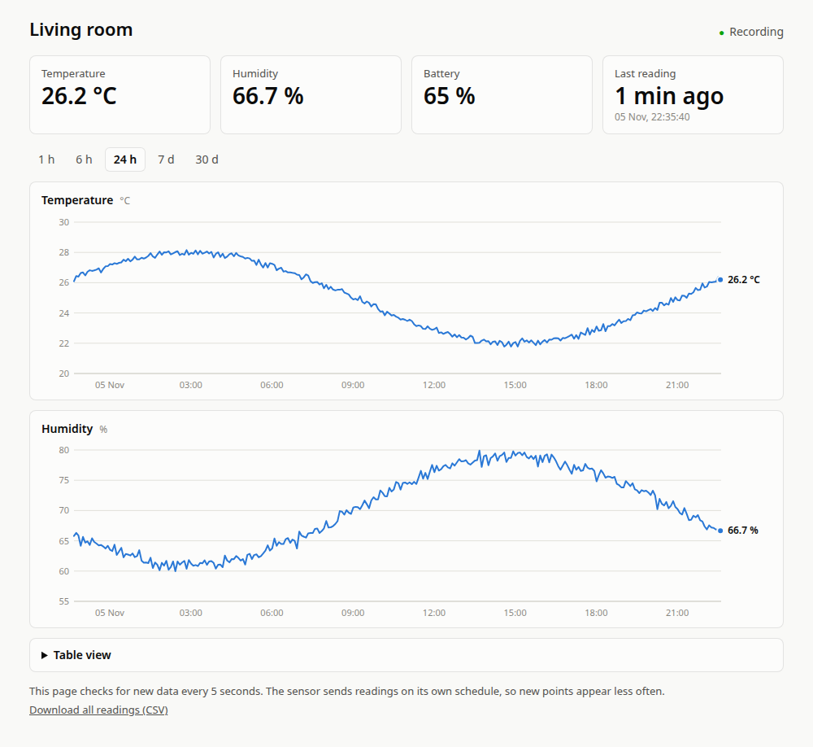

# Zigbee Climate Monitor

Records a Zigbee temperature and humidity sensor on your own machine and shows
the history on a web page that any device on your home network can open. It
needs no vendor hub, cloud account or app.



*Screenshot uses simulated data.*

## How it fits together

```text
Zigbee sensor ))) USB stick ─ Zigbee2MQTT ─ Mosquitto ─ dashboard ─ web page (LAN)
                                  │             │          │
                            web UI, localhost   │      SQLite file
                                          localhost only
```

Everything runs in Docker from one `docker-compose.yml`:

| Service | Job | Reachable from |
|---|---|---|
| `zigbee2mqtt` | Talks to the USB stick, publishes readings to MQTT. Web UI on port 8080. | This machine only |
| `mosquitto` | MQTT broker on port 1883, with no password. | This machine only |
| `dashboard` | Stores readings in SQLite and serves the read-only page on port 8090. | Your LAN |

## Requirements

- Linux with Docker and Docker Compose, and your user in the `docker` group
- A Zigbee USB stick that [Zigbee2MQTT supports](https://www.zigbee2mqtt.io/guide/adapters/)
- A Zigbee temperature and humidity sensor

Tested with a Dongle Plus-E stick and a Tuya TS0201 sensor. See
[AGENTS.md](AGENTS.md) for exact details and known problems.

## Install

> **Warning:** on first start, Zigbee2MQTT replaces any network already stored on
> the stick. If the stick has paired devices you want to keep, read
> [Moving to another machine](AGENTS.md#moving-to-another-machine) first.

```bash
git clone https://github.com/eusoubrasileiro/zigbee-climate-monitor.git
cd zigbee-climate-monitor

# Create the folders first, so Docker doesn't create them owned by root
mkdir -p z2m-data mosquitto/data dashboard/data
chmod 700 z2m-data

# Create your settings, then edit ZIGBEE_SERIAL_PORT in .env
cp .env.example .env
cp zigbee2mqtt/configuration.example.yaml z2m-data/configuration.yaml

docker compose up -d --build
docker logs -f zigbee2mqtt   # wait for "Zigbee2MQTT started!", then press Ctrl+C
```

If your stick isn't a Silicon Labs one, set the right `adapter` in
`z2m-data/configuration.yaml` before starting.

## Pair the sensor

```bash
scripts/pair.sh
```

While it runs, put the sensor in pairing mode **once**. Most sensors use a long
press of about 5 seconds, until the network icon blinks. Pressing again after it
joins makes it leave the network.

The script prints the sensor's MQTT topic. Put it in `.env` as `SENSOR_TOPIC`, then
apply it:

```bash
docker compose up -d
```

## Use it

Open `http://<this-machine's-LAN-IP>:8090` on any device on your network. Find the
IP with `hostname -I`. A DHCP reservation on your router keeps it from changing.

The page checks for new data every 5 seconds, but battery sensors decide for
themselves when to report, so new points may appear much less often.

The Zigbee2MQTT admin UI is at http://127.0.0.1:8080, on this machine only.

## Security

- **The page has no login.** Anyone on your LAN can read it, but it offers no way
  to change anything.
- **The broker and Zigbee2MQTT UI have no login either**, so both are bound to
  `127.0.0.1`. Add authentication before exposing them. Docker's published ports
  bypass UFW, so the firewall won't protect them.
- **`z2m-data/` holds your Zigbee network key.** It and `.env` are ignored by git.
  Keep it that way.

## Back up

GitHub holds only the code. Your data lives in these folders:

| Path | Contents | If lost |
|---|---|---|
| `z2m-data/` | Network key, paired devices | Every device must be paired again |
| `dashboard/data/` | All recorded readings | The history is gone |
| `.env` | Local settings | Recreate from `.env.example` |

To stop the services and copy them safely, see
[Moving to another machine](AGENTS.md#moving-to-another-machine). Treat any backup
of `z2m-data/` as a secret.

## Run the tests

```bash
docker compose build dashboard
docker run --rm --network none -v "$PWD/dashboard/test_app.py:/app/test_app.py:ro" \
  -w /app sensor-dashboard:local python -m unittest -v test_app
```
